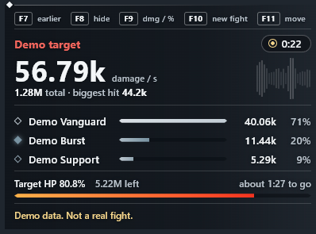
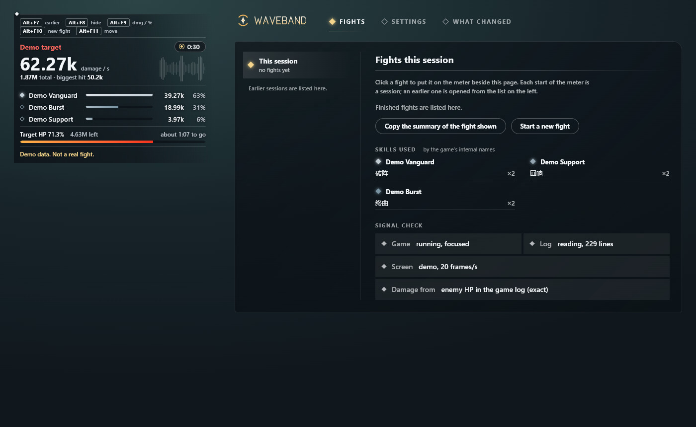
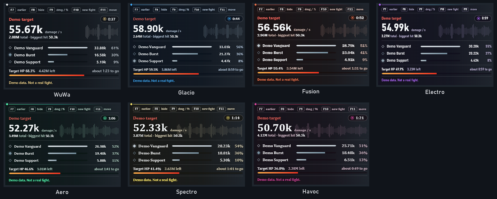

<div align="center">


**A damage meter for Wuthering Waves that never touches the game.**

[**Download**](../../releases/latest) · [What's new](CHANGELOG.md) · [How it works](docs/HOW-IT-WORKS.md) · [Report a problem](../../issues/new/choose)




</div>

> [!WARNING]
> Waveband is an unofficial fan tool. User discretion is advised, and to run a third-party tool next to the game is your own choice.

Waveband shows each character's damage live while you fight. It reads the log file the game
already writes and looks at the boss's HP bar, the same way you would. It doesn't touch the game
itself: no injecting, no memory reading, no key presses.

## Getting started

1. Grab the **installer** (`Waveband-<version>-setup.exe`) from the [releases page](../../releases/latest).
   It needs no admin rights and keeps itself up to date. Prefer nothing installed? Take the
   **zip** and run `Waveband.exe` from wherever you unzip it.
2. Set the game to **Borderless** or **Windowed**.
3. Start Waveband and fight something. The meter shows up over the game; quit from the tray icon.

Windows may say the program is from an unknown publisher, since it isn't code-signed yet: click
*More info*, then *Run anyway*.

## What you get

**Live damage per character.** Damage per second, each character's share, the biggest hit, and the
boss's HP with the time left to kill it. Damage goes to whoever's on field, and an ultimate's
cutscene damage goes to the character who used it.

**Exact where the game allows it.** Bosses that log their HP are measured to the point. The rest
are read off their HP bar and turned into real damage using their actual HP from the game's own
data, for wherever you're fighting them (hologram, tower, open world). Damage over time the log
skips, like Frazzle or Chafe, shows in its own *Over time* row.

**Every fight, kept.** Step back through earlier fights with F7, browse whole sessions on the
dashboard, and copy a fight's summary to paste into chat.



**And also:**

- Themes: **WuWa**, plus one for each element (Glacio, Fusion, Electro, Aero, Spectro, Havoc) in
  that element's colours
- A one-line meter, hiding between fights, and staying out of screenshots and streams
- Rows that show what you care about: damage per second, total, share, or time on field
- Keys you rebind by pressing them, and all your settings as one line for another PC
- Bosses and characters named the way your game names them, in any of its ten text languages
- One click to update boss data after a patch; Waveband tells you when it's needed



## Keys

Only active while the game is in front. Change them in Settings.

| Key | |
|---|---|
| F7 / Shift+F7 | Previous / next fight |
| F8 / Shift+F8 | Hide or show / one-line meter |
| F9 | Damage or percent of HP |
| F10 | New fight |
| F11 | Move and resize (scroll to resize, F11 to lock) |

## Good to know

- Windows only. Tested at 2560x1440 and 1920x1080; reports from 4K and ultrawide are welcome.
- Enemies that don't log their HP and have no boss bar show no damage.
- No per-skill damage, crits or healing: the game's log doesn't have them.
- Nothing about you or your game is sent anywhere. Waveband goes online only to check for its own
  updates (you can turn that off) and, when you ask, to fetch boss data after a patch.
- Updates are only installed if they carry Waveband's own signature. Want new versions early?
  Switch *Updates to take* to Beta in Settings.

**Something wrong?** Run *Waveband self-test* from the Start menu (or `selftest.bat` in the zip)
and attach the `selftest.txt` it makes to [a new issue](../../issues/new/choose). More fixes are
in [How it works](docs/HOW-IT-WORKS.md#if-something-looks-wrong).

## For developers

```powershell
git clone https://github.com/ShimaMDS/waveband.git
cd waveband
run.bat                                        # sets up .venv on first run, then starts the meter
.venv\Scripts\python -m wwmeter run --demo     # a made-up fight, no game needed
.venv\Scripts\python -m pip install -r requirements-dev.txt   # for the tests and tools\
.venv\Scripts\python -m unittest discover -s tests
```

Python 3.11 or newer. Inside the code, Waveband is still called `wwmeter`.
[How it works](docs/HOW-IT-WORKS.md) covers the internals and every tool;
[RELEASING.md](docs/RELEASING.md) covers builds and signed releases.

## Credits

- **Game data:** enemy HP, names and character elements come from the game's own tables, as
  published per version by [Arikatsu/WutheringWaves_Data](https://github.com/Arikatsu/WutheringWaves_Data).
- **Character list:** from [wuwaflex.com](https://wuwaflex.com)'s builder data, checked against
  [Prydwen](https://www.prydwen.gg/wuthering-waves/).
- **Ideas:** the FFXIV overlays [Ember Overlay](https://github.com/GoldenChrysus/ffxiv-ember-overlay)
  and [kagerou](https://github.com/hibiyasleep/kagerou), and [ok-ww](https://github.com/ok-oldking/ok-wuthering-waves)'s
  self-updating installer.
- **Built with** Python, [Qt for Python](https://doc.qt.io/qtforpython-6/), NumPy, ONNX Runtime,
  BetterCam, websockets, pywin32 and Pillow; the boss title is read with
  [PaddleOCR](https://github.com/PaddlePaddle/PaddleOCR)'s text recognizer as packaged by
  [RapidOCR](https://github.com/RapidAI/RapidOCR) (Apache-2.0, `data/ocr`); packaged with PyInstaller and
  [Inno Setup](https://jrsoftware.org/isinfo.php).

## License

Free software under the [GNU AGPL, version 3 or later](LICENSE): use it, change it, share it, and
share your source if you share a changed version or run one as a service.

Wuthering Waves and its names, text and data are © Kuro Games. The game data in
`data/enemy_hp.json` is included for the meter to work and isn't covered by the license above.
Waveband isn't affiliated with Kuro Games.
